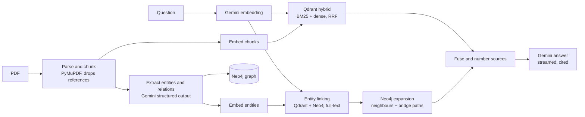

# SimplyReview

Ask questions across a library of research papers and get answers that cite every claim.

Each question runs through **two retrievers in parallel**, and their evidence is fused before Gemini writes the answer:

- **Hybrid passage search (Qdrant).** BM25 keyword vectors and Gemini dense embeddings are queried together and fused with Reciprocal Rank Fusion. Keywords catch exact names and numbers ("WMT 2014", "F1"); dense vectors catch paraphrases.
- **Knowledge-graph search (Neo4j).** At ingestion, Gemini extracts methods, models, datasets, metrics and tasks, and the relations between them (`EVALUATED_ON`, `OUTPERFORMS`, `EXTENDS`…), merging the same entity across papers. At query time the question is linked to entities by meaning and by name, and the graph is walked one hop out, plus short paths that connect the matched entities. This surfaces cross-paper connections that no single passage states.

The dashboard streams every stage live: a waterfall shows both retrievers running side by side, the answer streams in with clickable citations, and the knowledge graph lights up the entities the answer used.

## Architecture



| Layer | Choice |
| --- | --- |
| Backend | Python 3.14, FastAPI, managed with uv; Server-Sent Events for live progress |
| Vector store | Qdrant (named dense vector + sparse BM25 vector with server-side IDF) |
| Graph store | Neo4j (`Paper`, `Chunk`, `Entity`, `RELATES`, `MENTIONS`, `DISCUSSES`) |
| Models | `gemini-3.5-flash` (answers), `gemini-3.5-flash-lite` (extraction), `gemini-embedding-001` (768-d) |
| Frontend | Next.js 16, React 19, react-force-graph |
| Hosting | Vercel Services: one project, Next.js + Python function |

Heavy libraries (Gemini SDK, Qdrant and Neo4j clients, PyMuPDF) are imported lazily inside the functions that use them, so cold starts only pay for what a request touches.

## Run locally

Requirements: [uv](https://docs.astral.sh/uv/), Node 20+, Docker.

```bash
# 1. Databases: Neo4j locally (Qdrant runs in Qdrant Cloud; add --profile local-qdrant to run it locally too)
docker compose up -d

# 2. Backend
cd backend
cp .env.example .env          # fill in GEMINI_API_KEY, QDRANT_URL, QDRANT_API_KEY
uv sync
uv run uvicorn main:app --reload --port 8000

# 3. Frontend (proxies /api to the backend)
cd ../frontend
npm install
npm run dev                   # http://localhost:3000
```

Bulk-load papers from disk (same pipeline as the upload button, no size limit):

```bash
cd backend && uv run python ingest_cli.py ~/papers/*.pdf
```

Tests: `cd backend && uv run pytest`.

## Deploy to Vercel

`vercel.json` defines two services in one project: `frontend` (Next.js) and `backend` (FastAPI, `main:app`). `/api/*` goes to Python, everything else to Next.js.

1. Create a free Neo4j Aura instance and a Qdrant Cloud cluster.
2. Import the repository in Vercel and add the environment variables from `backend/.env.example`. Set `ADMIN_TOKEN` so only you can add papers to the public demo.
3. Deploy. Ingest large libraries with `ingest_cli.py` pointed at the same cloud databases.

## Limits

- Uploads through the hosted app are capped at 4.4 MB per PDF (Vercel's request-body limit). Use the CLI for larger files.
- The Gemini free tier allows 100 embedding requests per minute; each chunk and each entity counts. Ingestion waits and retries automatically, so large papers are slower on the free tier.
- Scanned PDFs without a text layer are rejected (no OCR).
